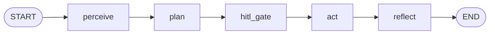

# LangGraph Walkthrough

This document explains the live agent path behind the guided UI. The static UI
is deterministic for demo reliability, but `scripts/run_poc.py` runs the real
LangGraph flow against Atlas, Voyage embeddings, and Claude.

## What LangGraph Does In This App

LangGraph turns the rain-delay scenario into an explicit state machine:



The graph is intentionally linear in V1. That keeps the tutorial easy to run
and inspect while preserving the insertion point for future production approval
logic.

## Code Map

| File | What to look for |
|------|------------------|
| `src/event_venue_operator/graph.py` | Graph assembly, edges, compile call, `run_agent()`, and `stream_agent()` |
| `src/event_venue_operator/state.py` | `OperatorState`, the shared state passed between nodes |
| `src/event_venue_operator/nodes.py` | The five node functions: `perceive`, `plan`, `hitl_gate`, `act`, `reflect` |
| `src/event_venue_operator/tools.py` | Tool functions that write plans, reservations, and action logs to Atlas |
| `src/event_venue_operator/db.py` | `MongoDBSaver`, `MongoDBStore`, MongoDB helpers, and Voyage embeddings |
| `scripts/run_poc.py` | The command-line proof path for the live LangGraph scenario |

## The Architectural One-Liner

The most important implementation detail is the graph compile step:

```python
compiled = graph.compile(
    checkpointer=get_checkpointer(),
    store=get_store_for_graph(),
)
```

This wires Atlas into LangGraph in two ways:

- `MongoDBSaver` stores graph checkpoints in `checkpoints` and
  `checkpoint_writes`.
- `MongoDBStore` stores long-term semantic memory in `memory_store` with Voyage
  embeddings and Atlas Vector Search.

That is the core backend claim: operational records, vector memory, agent
checkpoints, and audit logs all live in one Atlas-backed application state
layer.

## Node Walkthrough

### 1. `perceive`

`perceive` gathers the context Claude should reason over. It retrieves prior
visitor memories, operator-level patterns, current venue status, and active
weather events.

Business meaning: before the agent plans, it asks, "What has happened to these
visitors before, what does the operator know from prior events, and what is
happening at the venue right now?"

Atlas proof points:

- Reads visitor/persona context from `guests`
- Reads visit history from `visits`
- Reads live context from `venue_status` and `weather_events`
- Searches `memory_store` with namespaced vector retrieval

### 2. `plan`

`plan` calls Claude Sonnet 4.6 with the retrieved context. Claude is instructed
to produce persona-specific rain-delay actions for Mikiko and Nina.

The plan node binds two tools:

- `update_itinerary`
- `book_reservation`

Business meaning: Mikiko gets first-time visitor routing to avoid another missed
match start; Nina gets protected covered seating and hospitality continuity.

### 3. `hitl_gate`

`hitl_gate` is the human-in-the-loop insertion point. In V1, it auto-approves
all actions so the tutorial remains simple and runnable.

Business meaning: the graph already has the shape needed for future approval
logic, but V1 does not implement production approvals, escalations, or denials.

### 4. `act`

`act` executes the approved tools. It writes the planned actions and reservation
results back to Atlas.

Atlas proof points:

- Updates `visits` with planned venue actions
- Writes reservation data
- Logs tool execution to `agent_actions`

### 5. `reflect`

`reflect` writes new learned signals back into semantic memory. This is how a
single event can influence future events.

Atlas proof point:

- Writes new memory entries into the `("guests", guest_id)` namespace in
  `memory_store`

## Run The Live Graph

After setup and seeding, run:

```bash
uv run python scripts/run_poc.py
```

The output should show:

- Retrieved perception context
- The proposed tool action
- The action result
- The generated itinerary from the `visits` collection

The exact plan can vary because Claude is planning from retrieved context.
That variation is expected; the seeded memories and prompt keep the run aligned
to the Mikiko/Nina tennis rain-delay scenario.

## What To Inspect In Atlas

After running `scripts/run_poc.py`, inspect these collections:

| Collection | Why it matters |
|------------|----------------|
| `visits` | Shows the generated venue plan and reservation outcome |
| `agent_actions` | Shows the tool audit trail |
| `memory_store` | Shows retrieved and newly written semantic memory |
| `checkpoints` | Shows LangGraph state snapshots |
| `checkpoint_writes` | Shows node-level checkpoint writes |

## What Is Intentionally Out Of Scope

- The guided UI does not invoke the full LangGraph chain.
- `hitl_gate` auto-approves actions in V1.
- Langfuse traces the run-level `langgraph.run_agent` observation when
  configured; individual node spans are not traced in V1.
- Change streams are available as an extension path, but are not wired into the
  V1 UI.
- The graph is single-scenario and tutorial-focused, not a production
  orchestration platform.
